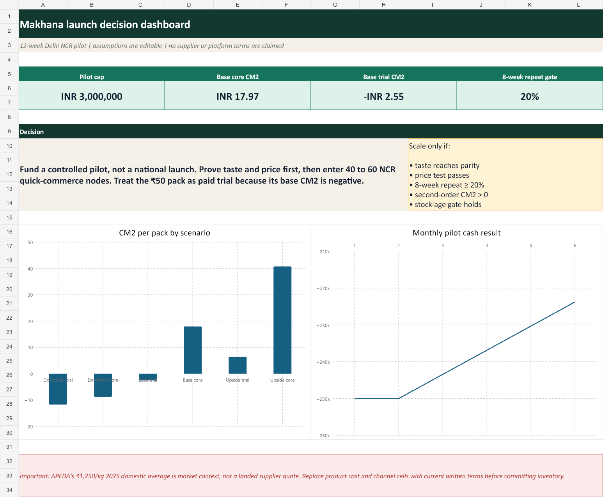

# Makhana snack launch plan for Delhi NCR

I first worked on this category in college. That version moved too quickly from an interesting market to a large launch. It did not prove whether people preferred the product, would pay the planned price or would buy it again.

I rebuilt the project around those unanswered questions.

## The problem

A new makhana snack can look attractive on market size alone and still fail because the taste is weak, the pack is too expensive or channel costs remove the margin. The aim here is to decide what should be tested before paying for broad distribution.

## What I did

- Audited the arithmetic and assumptions in my original college plan.
- Researched the category, input-price context, competitors, regulations and channel options.
- Built pack-level economics for downside, base and upside cases.
- Designed consumer interviews, blind taste tests and price tests.
- Turned the work into a 12-week Delhi NCR pilot with clear rules for scaling, changing or stopping.



## Recommendation

**Run a controlled pilot before considering a larger launch.**

- Start with Chatpata Masala and Cream & Onion.
- Test a 20 g trial pack near ₹50 and a 50 g core pack near ₹149.
- Use office tastings and 20 to 30 selected stores before entering quick commerce.
- Expand to 40 to 60 quick-commerce nodes only if taste and price tests pass.
- Require at least 20% identifiable repeat within eight weeks.
- Check that the second order remains profitable after product, channel, fulfilment and variable marketing costs.

The pilot is capped at ₹30 lakh. The prices, fees and pass rules are working assumptions that can be changed in the model.

## What the model shows

APEDA's November 2025 dashboard reported an average domestic makhana price of ₹1,250 per kg in 2025. At that level, the 60 g pack at ₹99 in my old plan would contain about ₹75 of raw makhana before sorting loss, seasoning, packaging, processing or freight. That was enough to reject the old cost assumption.

In the current base case:

- the 20 g trial pack loses ₹2.55 after variable launch costs, so it should be treated as a trial tool rather than the main profit pack;
- the 50 g core pack contributes ₹17.97 after the same costs;
- wider distribution happens only after taste, repeat, inventory and contribution checks pass.

These are planning outputs, not supplier quotes or launch results.

## Project files

| File | What it contains |
|---|---|
| [Full strategy](report-source.md) | The market read, target customer, product, channels, launch sequence, economics and risks |
| [Original-plan audit](legacy/what-i-would-change.md) | The arithmetic and assumptions I changed from the college version |
| [Excel model](finance/makhana-gtm-model.xlsx) | Pack economics, monthly cash, pilot budget and sensitivity cases |
| [Presentation](deck/makhana-launch-gtm.pdf) | A 14-slide summary of the recommendation and evidence |
| [Editable PowerPoint](deck/makhana-launch-gtm.pptx) | The presentation source file |
| [Launch plan](strategy/launch-plan.md) | Twelve weeks of activities, owners, budget and outputs |
| [Test and scale rules](strategy/experiments-and-gates.md) | The result needed before more money is spent |
| [Conversion plan](strategy/conversion-and-recovery.md) | The path from first exposure to repeat purchase and how to diagnose drop-offs |
| [Consumer interview guide](research/consumer-interview-guide.md) | Questions for regular, occasional and non-makhana buyers |
| [Taste-test sheet](research/taste-test-scorecard.csv) | A ready-to-use blind product test |
| [Competitor prices](research/competitor-price-snapshot.csv) | Pack and price observations collected on 30 August 2026 |
| [Source ledger](research/source-ledger.csv) | Source, access date and limitation for each important claim |

The original four-page college appendix is kept in `legacy/` so the improvement is visible.

## What still needs real-world testing

Before launch, I would collect manufacturer quotes, complete the interviews and taste tests, confirm trade terms, test shelf life and obtain regulatory sign-off for the actual product and label. This project builds the decision process and working model. It does not invent those results.

## Reproduce the core calculations

```bash
python scripts/model.py
```

The script uses the Python standard library and writes the scenario and monthly tables to `outputs/`.
